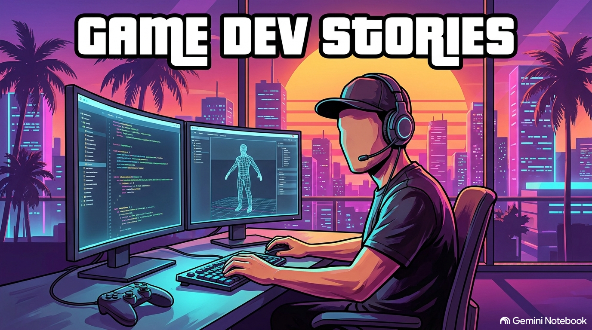
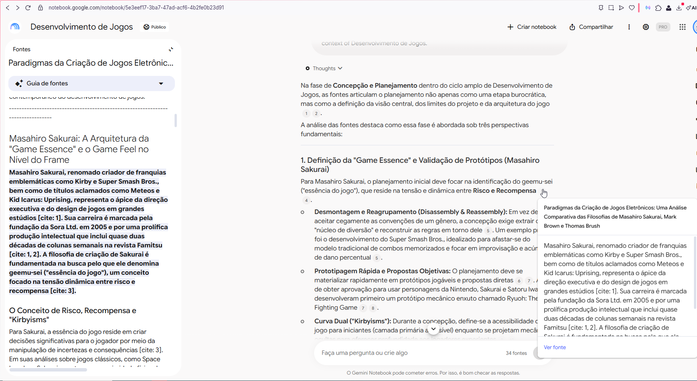
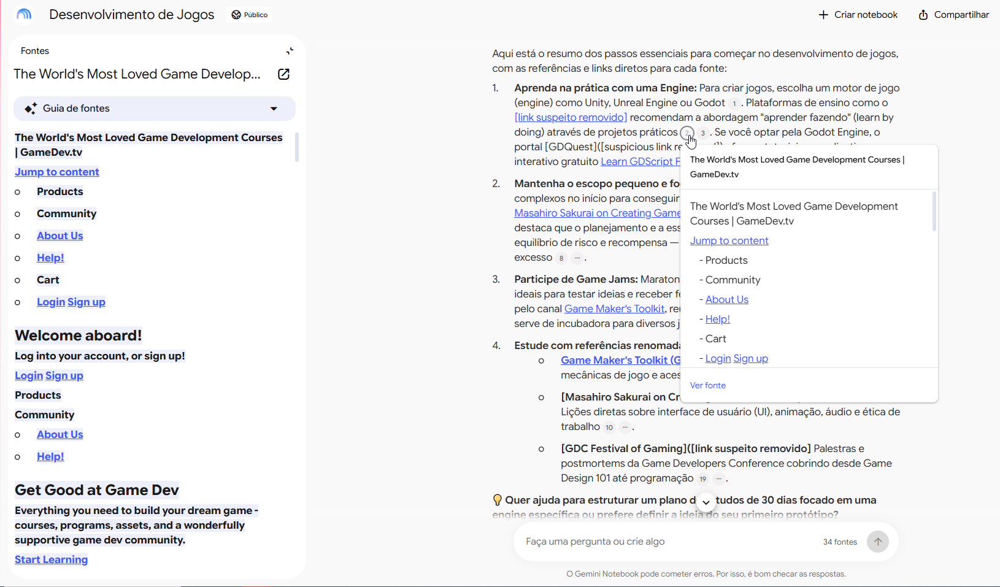
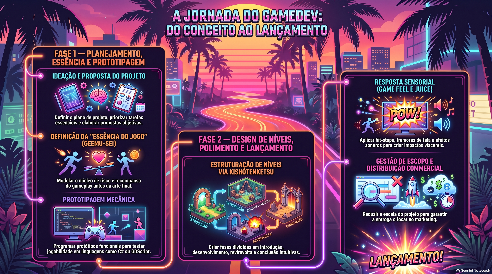

# Tema: Criação de Games
> Objetivo: Criar um segundo celebro para aprendizagem sobre criação de games.

[Link para o NotebookLM](https://notebook.google.com/notebook/5e3eef17-3ba7-47ad-acf6-4b2fe0b23d91)

Fontes:
- https://www.youtube.com/@GMToolkit - Mark Brown - Jornalista de jogos, um dos maiores educadores de game design do mundo.
- https://www.youtube.com/@sora_sakurai_en - Masahiro Sakurai - criador de Super Smash Bros. e Kirby
- https://www.youtube.com/channel/UC0JB7TSe49lg56u6qH8y_MQ - GDC – Game Developers Conference - A maior conferência de desenvolvedores do mundo.Nela, grandes mentes da indústria (incluindo desenvolvedores da Valve, Riot Games, Nintendo e estúdios independentes de sucesso) revelam os bastidores técnicos de suas produções.

#### Diretriz:
Você deve atuar como um professor (mestre) em desenvolvimento de jogos.
Com base nas fontes, extrair apenas o que diz respeito ao processo de desenvolvimento de jogos, tanto pratico quanto teórico, de forma que seja um curso completo.

#### Pessoas a Seguir:
- Mark Brown
- Masahiro Sakurai
- Thomas Brush -  é o reflexo do desenvolvedor indie moderno. Criador solo por trás de jogos artisticamente deslumbrantes como Pinstripe e Neversong. Ele divide o tempo entre ensinar a criar jogos e ensinar como comercializá-los.

#### Plataformas de aprendizado:
- GameDev.tv

#### Motores:
- Godot Engine
- Unity 
- GDevelop 
- Unreal Engine

#### Fontes adicionais:
- https://gamemakerstoolkit.com
- https://learn.unity.com
- https://learn.unity.com/course/create-with-code
- https://www.gdquest.com
- https://docs.godotengine.org/en/stable/
- https://school.gdquest.com/courses/learn_2d_gamedev_godot_4/learn_gdscript/learn_gdscript_app
- +Pesquisadas com Deep research

# Perguntas e respostas:

## Quero começar a desenvolver jogos, resuma como posso fazer isto ?

Aqui está o resumo dos passos essenciais para começar no desenvolvimento de jogos, com as referências e links diretos para cada fonte:

1. **Aprenda na prática com uma Engine:**
   Para criar jogos, escolha um motor de jogo (*engine*) como Unity, Unreal Engine ou Godot. Plataformas de ensino como o [GameDev.tv](https://gamedev.tv/) recomendam a abordagem "aprender fazendo" (*learn by doing*) através de projetos práticos. Se você optar pela Godot Engine, o portal [GDQuest]([https://www.gdquest.com]) oferece tutoriais e o aplicativo interativo gratuito [Learn GDScript From Zero](https://gdquest.com/tutorial/godot/learning-paths/learn-gdscript-from-zero/).

2. **Mantenha o escopo pequeno e foque na essência:**
   Evite projetos muito complexos no início para conseguir finalizar seus protótipos. No canal [Masahiro Sakurai on Creating Games](https://www.youtube.com/@sora_sakurai_en), o criador de *Kirby* e *Super Smash Bros.* destaca que o planejamento e a essência do jogo (*Game Essence*) — baseada no equilíbrio de risco e recompensa — vêm antes de adicionar mecânicas em excesso.

3. **Participe de Game Jams:**
   Maratonas de criação de jogos em tempo limitado são ideais para testar ideias e receber feedback. A [GMTK Game Jam](https://gamemakerstoolkit.com/jam/), organizada pelo canal [Game Maker's Toolkit](https://gamemakerstoolkit.com/), reúne milhares de participantes anualmente e serve de incubadora para diversos jogos que chegam ao mercado.

4. **Estude com referências renomadas:**
   * **[Game Maker's Toolkit (GMTK)](https://gamemakerstoolkit.com/):** Análises profundas de *level design*, mecânicas de jogo e acessibilidade.
   * **[Masahiro Sakurai on Creating Games]([link suspeito removido]** Lições diretas sobre interface de usuário (UI), animação, áudio e ética de trabalho.
   * **[GDC Festival of Gaming]([link suspeito removido]** Palestras e *postmortems* da Game Developers Conference cobrindo desde *Game Design 101* até programação.

💡 **Quer ajuda para estruturar um plano de estudos de 30 dias focado em uma engine específica ou prefere definir a ideia do seu primeiro protótipo?**

### Evidências das referências:

#### Referência 1

#### Referência 2

#### Referência 3

# Formatos do Estudio Gerados

### A Jornada do Gamedev

#### Mapa Mental

#### Apresentação
[Processo de Criação de Jogos](conteudos/Game_Dev_Blueprint.pdf)

